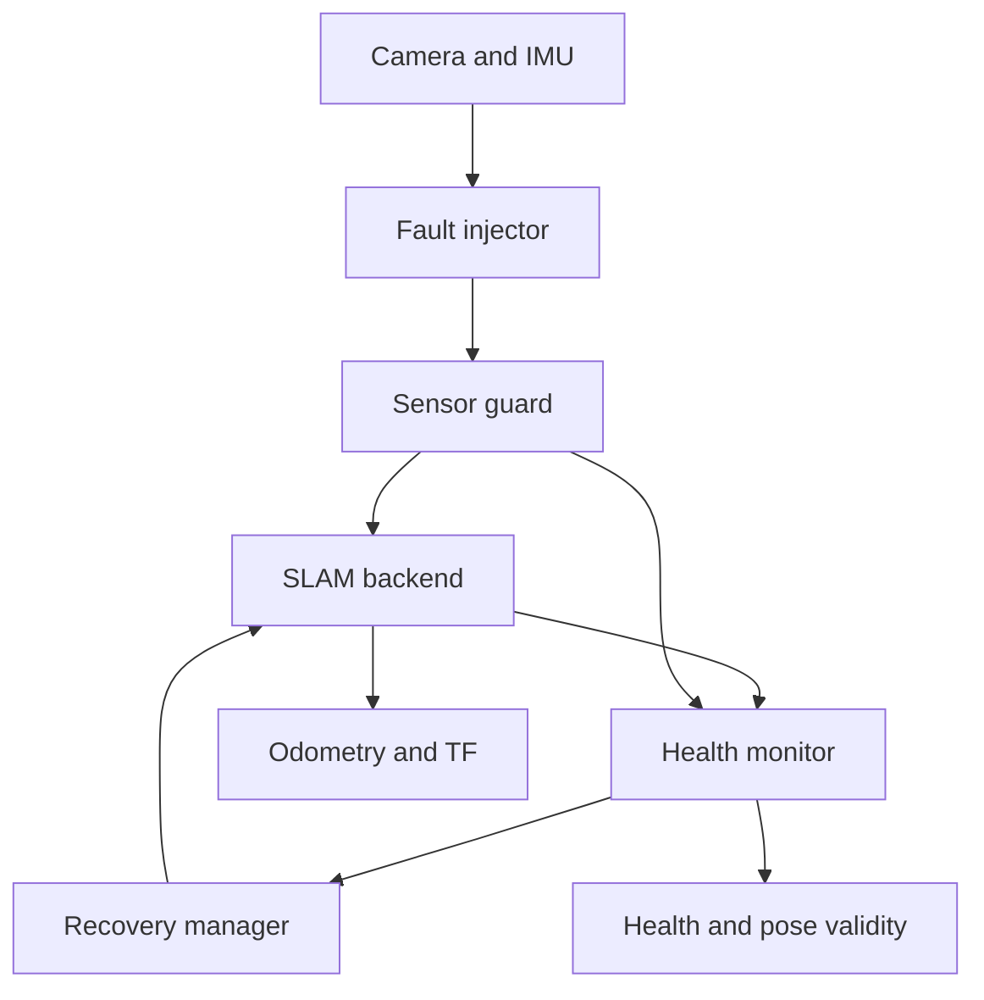

# Visual-Inertial SLAM with Failure Detection and Relocalization

A ROS 2 Jazzy system that makes stereo-inertial localization failure explicit,
invalidates unsafe poses, and distinguishes genuine same-map relocalization from
resetting onto a new map. It integrates a version-pinned ORB-SLAM3 backend,
timestamp-faithful EuRoC playback, deterministic fault injection, and a
one-command evidence-generating benchmark.

## Why this project matters

Odometry publication alone does not prove that localization is usable. A SLAM
backend may publish a frozen or stale pose during failure, and "tracking is good
again" does not reveal whether it recovered against the original map or silently
created a new one. This project gives downstream software an explicit
`pose_valid` contract and makes map identity part of the recovery verdict.

The key experimental finding was that a camera blackout and a visual occlusion
are not equivalent for stereo-inertial SLAM. Dropped camera messages create a
timestamp discontinuity and can force a new map; black but timestamp-continuous
images allow a true same-map relocalization test.

## Verified real-backend result

On EuRoC `MH_01_easy`, the final automated validation run produced:

```text
INITIALIZING → HEALTHY → RELOCALIZING → RECOVERED → HEALTHY
map IDs: [0]
```

| Measurement | Observed value |
|---|---:|
| `RECOVERED` after visibility returned | 395 ms |
| `HEALTHY` after visibility returned | 895 ms |
| Active map IDs | `[0]` |

A separate camera-blackout run created the expected timestamp jump and changed
the active map from 0 to 1; the system classified it as reset/reinitialization,
not relocalization success. These are single-sequence engineering validation
results, not aggregate performance claims. See the [case study](docs/case-study.md)
and the [final automated benchmark report](results/20260809T185401Z/report.md).

The repository is deliberately split into two layers:

- a backend-independent health and recovery layer that builds and runs immediately;
- a SLAM adapter boundary where ORB-SLAM3 or another estimator publishes the standard `vif_interfaces` contract.

The default synthetic demo does **not** require ORB-SLAM3, a camera, or a dataset. It produces camera/IMU traffic, injects a timed camera blackout, detects loss, invalidates the pose, requests relocalization, and verifies recovery.

## What is implemented

- Stereo and IMU timestamp/rate/staleness monitoring
- Explainable health score from sensor and tracker signals
- Hysteretic localization state machine
- Explicit `pose_valid` output for downstream consumers
- Recovery manager with relocalization, reset timeout, and cooldown
- Deterministic mock SLAM backend for end-to-end testing
- Real ROS 2 stereo-inertial ORB-SLAM3 adapter against a pinned external build
- Bounded IMU buffering, stereo synchronization, REP-103 pose conversion, and TF gating
- Truthful per-frame backend diagnostics through a version-controlled ORB-SLAM3 patch
- Timestamp-faithful EuRoC stereo/IMU playback with original nanosecond stamps
- Camera blackout, visual occlusion, frame-drop, timestamp-delay, and IMU-drop fault injection
- Machine-readable fault-window events that remain outside the online detector
- One-command clean/occlusion/blackout benchmark with isolated process cleanup
- JSON, CSV, Markdown, and raw-log evidence for every benchmark run
- ATE/RPE and failure/recovery metrics in a pure Python evaluation package
- Unit tests, launch test, lint configuration, Docker, and GitHub Actions
- Dataset manifest and EuRoC downloader with no dataset files committed

## System flow



Ground truth is only used offline by `vif_eval`; it is never an input to the online detector.

## Requirements

- Ubuntu 24.04
- ROS 2 Jazzy Desktop or ROS Base
- `colcon`, `rosdep`, and a C++17 compiler
- Python 3.12 (the Jazzy default on Ubuntu 24.04)

## Build locally

```bash
source /opt/ros/jazzy/setup.bash
cd vi-slam-health
rosdep install --from-paths src --ignore-src -r -y --rosdistro jazzy
colcon build --symlink-install --cmake-args -DCMAKE_BUILD_TYPE=RelWithDebInfo
source install/setup.bash
```

Run tests:

```bash
colcon test --event-handlers console_direct+
colcon test-result --verbose
python3 -m venv .venv
source .venv/bin/activate
python -m pip install -e 'evaluation[test]'
pytest evaluation/tests
python3 -m unittest discover -s tools/benchmark/tests -v
```

## Run the portfolio benchmark

After building the real adapter, run all three acceptance scenarios with one
command:

```bash
export EUROC_SEQUENCE=/absolute/path/to/MH_01_easy
export ORB_SLAM3_ROOT=/absolute/path/to/ORB_SLAM3

./tools/benchmark/run_portfolio_benchmark.sh \
  --dataset "$EUROC_SEQUENCE" \
  --vocabulary "$ORB_SLAM3_ROOT/Vocabulary/ORBvoc.txt" \
  --settings "$ORB_SLAM3_ROOT/Examples/Stereo-Inertial/EuRoC.yaml"
```

It produces `report.md`, `summary.json`, `summary.csv`, per-scenario results,
and separate backend/injector/player logs under `results/<UTC-run-id>/`. The
command exits non-zero if any ordered state, pose-validity, fault-event, or map-ID
invariant fails. See the [benchmark protocol](docs/benchmarking.md).

## Run the complete synthetic failure/recovery demo

```bash
source install/setup.bash
ros2 launch vif_bringup synthetic_demo.launch.py
```

In another terminal:

```bash
source install/setup.bash
ros2 topic echo /vif/localization/health
```

Expected sequence with the default scenario:

1. `INITIALIZING` while the mock backend starts.
2. `HEALTHY` with `pose_valid=true`.
3. At 8 seconds, a 3-second camera blackout begins.
4. The state becomes `LOST`, the score drops, and `pose_valid=false`.
5. The recovery manager requests relocalization.
6. When images return, the backend enters `RELOCALIZING` and then `RECOVERED`.
7. Stable tracking returns the system to `HEALTHY`.

To disable the scheduled fault:

```bash
ros2 launch vif_bringup synthetic_demo.launch.py inject_fault:=false
```

## Important topics and service

| Name | Type | Purpose |
|---|---|---|
| `/vif/sensors/health` | `vif_interfaces/msg/SensorHealth` | Sensor freshness and timing |
| `/vif/slam/tracking` | `vif_interfaces/msg/TrackingStatus` | Backend observability signals |
| `/vif/slam/odometry` | `nav_msgs/msg/Odometry` | Current pose estimate |
| `/vif/localization/health` | `vif_interfaces/msg/LocalizationHealth` | Health score, state, and validity |
| `/vif/fault/events` | `vif_interfaces/msg/FaultEvent` | Exact injected-fault start/end evidence |
| `/vif/relocalization/events` | `vif_interfaces/msg/RelocalizationEvent` | Recovery audit trail |
| `/vif/slam/manage` | `vif_interfaces/srv/ManageSlam` | Relocalize/reset/new-map command |

See [docs/interfaces.md](docs/interfaces.md) for the exact contract and [docs/orbslam3_integration.md](docs/orbslam3_integration.md) for connecting a real backend.

## Health score

The default detector combines normalized feature count, inlier ratio,
reprojection error, sensor availability, and processing time. An exponentially
weighted moving average reduces single-frame noise. Hard tracker loss always
overrides the numeric score. A backend may publish `NaN` for an unavailable
floating-point diagnostic; the monitor excludes that value and renormalizes
the remaining weights.

The score is a diagnostic indicator, not a calibrated probability of correct localization. Thresholds in `config/health/default.yaml` must be tuned on development sequences and frozen before held-out evaluation.

## Evaluation

Install the evaluation package and run:

```bash
vif-eval trajectory --estimate estimate.tum --ground-truth groundtruth.tum --output results.json
vif-eval failures --events events.csv --labels labels.csv --output failure_results.json
```

The trajectory command reports aligned ATE RMSE and translational RPE. The failure command reports precision, recall, F1, false alarms, detection delay, relocalization success, and recovery time.

The online recovery benchmark is complementary: it validates runtime state,
pose validity, recovery events, and map identity without feeding ground truth or
fault labels into the detector.

## Real SLAM backend

The `vif_orbslam3` package is implemented but disabled in the default build so
CI and the synthetic demo do not require a heavyweight external backend.
ORB-SLAM3 itself is not vendored. The adapter is reviewed for commit
`4452a3c4ab75b1cde34e5505a36ec3f9edcdc4c4` and checks that revision when its
Git metadata is available.

Apply the included diagnostics patch and build the adapter:

```bash
export VIF_REPOSITORY=/absolute/path/to/vi-slam-health
export ORB_SLAM3_ROOT=/absolute/path/to/ORB_SLAM3

cd "$ORB_SLAM3_ROOT"
git apply --check \
  "$VIF_REPOSITORY/third_party/patches/orb_slam3/0001-expose-tracking-diagnostics.patch"
git apply \
  "$VIF_REPOSITORY/third_party/patches/orb_slam3/0001-expose-tracking-diagnostics.patch"
./build.sh

cd "$VIF_REPOSITORY"
source /opt/ros/jazzy/setup.bash
colcon build --symlink-install \
  --cmake-args \
    -DVIF_BUILD_ORB_SLAM3_ADAPTER=ON \
    -DVIF_ORB_SLAM3_HAS_DIAGNOSTICS=ON \
    -DORB_SLAM3_ROOT="$ORB_SLAM3_ROOT"
source install/setup.bash
```

Launch it after a source publishes rectified stereo and IMU data on the VIF
input topics:

```bash
ros2 launch vif_bringup orbslam3.launch.py use_viewer:=true
```

To run the complete real-backend stack on an extracted EuRoC sequence:

```bash
export EUROC_SEQUENCE=/absolute/path/to/MH_01_easy

ros2 launch vif_bringup euroc_orbslam3.launch.py \
  dataset_path:="$EUROC_SEQUENCE" \
  vocabulary_path:="$ORB_SLAM3_ROOT/Vocabulary/ORBvoc.txt" \
  settings_path:="$ORB_SLAM3_ROOT/Examples/Stereo-Inertial/EuRoC.yaml" \
  use_viewer:=false
```

The player waits for both VIF consumers before sending the first measurement,
publishes the exact EuRoC camera and IMU timestamps at real-time pace, and shuts
down the launch cleanly when the sequence ends.

For real-backend recovery tests, use `visual_occlusion`: it replaces image
pixels with black frames while preserving the stereo timestamps and IMU stream.
This gives ORB-SLAM3 an opportunity to recover against the same map. A true
`camera_blackout` drops image messages. If tracking becomes `LOST` while the
camera is unavailable, the recovery manager requests an active-map reset
instead of same-map relocalization. The resulting map change is reported as
`RESETTING` rather than `RECOVERED`.

See [the complete ORB-SLAM3 integration guide](docs/orbslam3_integration.md)
for frame/extrinsic semantics, an unpatched fallback build, recovery behavior,
and the validation sequence.

The mock backend is for system testing only and must never be used for localization claims.

## Repository layout

```text
src/vif_interfaces/        messages and recovery service
src/vif_sensor_frontend/   camera/IMU timing guard
src/vif_health_monitor/    score and localization state machine
src/vif_relocalization/    recovery policy
src/vif_mock_slam/         deterministic test backend
src/vif_orbslam3/          pinned real ORB-SLAM3 ROS 2 adapter
src/vif_euroc_player/      timestamp-faithful EuRoC dataset playback
src/vif_fault_injection/   synthetic sensors and fault relay
src/vif_bringup/           launch and parameter files
evaluation/                offline metrics and tests
config/                    canonical experiment configuration
docs/                      architecture and integration guidance
tools/                     dataset and benchmark helpers
```

For a concise explanation of the engineering decisions and the central failure
mode, read [docs/case-study.md](docs/case-study.md). A ready-to-record demo
outline is available in [docs/demo-script.md](docs/demo-script.md).

## License

GPL-3.0-or-later. This repository is license-compatible with a linked ORB-SLAM3 integration. Dataset licenses and attribution remain separate; datasets are downloaded from their official hosts and are not redistributed here.

## Status

This package is a complete, testable `v0.3.0` health/recovery framework. The
real ORB-SLAM3 adapter is implemented and version-pinned; ORB-SLAM3 itself,
sensor calibration, and datasets remain external environment-specific inputs.
