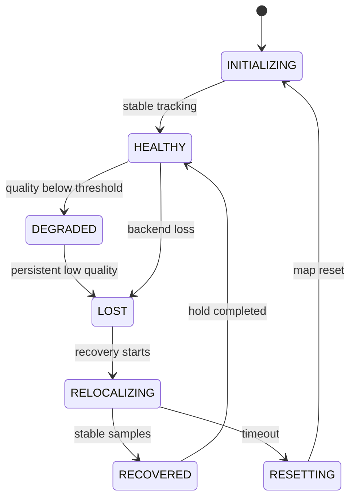

# Architecture

## Runtime boundaries

`vif_sensor_frontend` owns transport-level evidence: message arrival, timestamp order, stereo skew, rates, and IMU gaps. It does not judge geometric tracking.

The SLAM backend owns estimation evidence: tracking state, feature count, inlier ratio, reprojection error, processing time, pose, map identity, and the implementation of recovery commands.

`vif_health_monitor` fuses those two evidence sources. It has no ground-truth subscription and no dataset-specific code. The numeric score is smoothed, but explicit backend loss and sensor absence are hard overrides.

`vif_relocalization` is policy, not estimation. It requests recovery, audits events, enforces timeouts, and can escalate to a reset. It never declares a recovered pose by itself; recovery must be observed through health state.

The benchmark observer is outside the online decision path. It subscribes to
health, tracking, recovery, and labelled fault events solely to record evidence
and validate ordered acceptance criteria. No benchmark or ground-truth signal is
fed into the sensor guard, backend, health monitor, or recovery manager.

## State transitions

The real ORB-SLAM3 adapter reports an active-map identifier on every tracking
sample. A change in that identifier is surfaced by the health monitor as
`RESETTING`; later initialization on a new map is not counted as relocalization
success. A recovery attempt succeeds only after the health state reaches
`RECOVERED` on the same map.

## Downstream contract

Consumers must use `/vif/localization/health.pose_valid`. They must not infer validity from whether odometry messages still arrive. A backend may publish a frozen pose with large covariance during loss for observability, while TF publication is stopped.

Recommended downstream behavior:

- `HEALTHY`: accept pose normally.
- `DEGRADED`: accept only if the application tolerates reduced confidence; inspect covariance.
- `LOST`, `RELOCALIZING`, `RESETTING`, `INITIALIZING`: reject pose.
- `RECOVERED`: accept only after checking whether a map-frame discontinuity is acceptable.

## Threading and failure containment

The reference nodes use ROS executors and bounded message-filter queues. Recovery service calls are asynchronous. No callback blocks waiting for a service or sleeps. Production composition can place the sensor guard and backend in separate processes if backend failure containment is more important than zero-copy transport.
